<picture>
  <source media="(max-width: 600px) and (prefers-color-scheme: dark)" srcset="assets/header-phone-dark.svg">
  <source media="(max-width: 600px)" srcset="assets/header-phone-light.svg">
  <source media="(prefers-color-scheme: dark)" srcset="assets/header-dark.svg">
  
</picture>

**[ttdevs.com](https://ttdevs.com)** <samp>in development</samp> 
My portfolio. Every project here, with screens.

**[epaRadar](https://github.com/tlxq/eparadar)** <samp>in development</samp> 
Map app for friends. My degree project.

**[ttoolbox](https://github.com/tlxq/ttoolbox)** <samp>daily use</samp> 
My Claude Code plugins and dotfiles CLI.

**[raddavarfruberga.se](https://raddavarfruberga.se)** <samp>live</samp> 
Petition site for a parents' group. Over 1,000 signatures.
